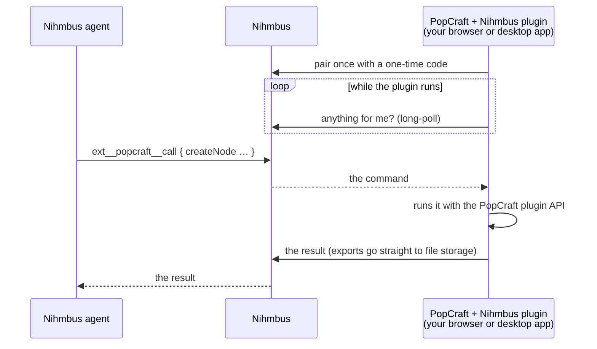

# PopCraft for Nihmbus

[](https://github.com/nihmbus/nihmbus-popcraft/actions/workflows/ci.yml)
[](LICENSE)

Let your [Nihmbus](https://nihmbus.ai) agents design graphics, motion and video in [PopCraft](https://popcraft.app):
in **your own PopCraft editor**, on the web or in the desktop app, signed in as you.

This repo is the Nihmbus side of the connection: an extension that gives agents PopCraft tools, plus skills that
teach them to use PopCraft well. The PopCraft side is the
[Nihmbus plugin for PopCraft](https://github.com/getpopcraft/popcraft-plugin-nihmbus).

## How it works



- **Nothing listens on your machine.** The plugin only makes outgoing requests to Nihmbus, so it works in a browser
  tab and in the sandboxed App Store app.
- **Your PopCraft is yours.** Only your own agent runs can use the editor you connected, and you can disconnect it
  from either side at any time.
- **Nothing is built into Nihmbus or PopCraft.** This extension uses Nihmbus's general
  [extension devices](https://github.com/nihmbus/nihmbus/blob/main/docs/extension-devices.md) feature, and the
  plugin uses PopCraft's public plugin API.

## What agents can do

| Tool                    | What it does                                                                                                                                                                                                |
| ----------------------- | ----------------------------------------------------------------------------------------------------------------------------------------------------------------------------------------------------------- |
| `ext__popcraft__status` | Show what's open: the current page, its layers and the selection.                                                                                                                                           |
| `ext__popcraft__call`   | Run [PopCraft plugin API](https://popcraft.app/docs/plugins/api-reference) methods: layers, text, styles, components, keyframes, motion presets, compositions, prototypes… (95 methods, up to 50 per call). |
| `ext__popcraft__export` | Export a layer as PNG, JPG, WEBP, SVG or PDF and return a link to the file.                                                                                                                                 |

The tool contract is in [docs/tools.md](docs/tools.md).

### Skills

| Skill               | For                                                                           |
| ------------------- | ----------------------------------------------------------------------------- |
| `popcraft`          | Setup, connecting, the latest docs, and which tools run where                 |
| `popcraft-graphics` | Posters, social posts, banners, thumbnails                                    |
| `popcraft-motion`   | Animated posts, kinetic type, logo reveals, promos                            |
| `popcraft-video`    | MP4/GIF and short-form video sets                                             |
| `popcraft-social`   | Whole social campaigns: assets in every size, post copy, approval, publishing |

## Get started

1. **Install the extension in Nihmbus.** Open **Extensions → Install from Git**, enter `nihmbus/nihmbus-popcraft`,
   and allow **device** access.
2. **Install the plugin in PopCraft.** Open the main menu → **Manage plugins…**, search for **Nihmbus**, and install
   it. Or download the `.json` from the
   [plugin's releases](https://github.com/getpopcraft/popcraft-plugin-nihmbus/releases) and use **Installed → Install
   from file…**.
3. **Connect them.** In Nihmbus, open **Extensions → PopCraft → Connect PopCraft** to get a code. In PopCraft, click
   the **Nihmbus** icon in the right-hand rail and enter it. The icon turns into the coloured Nihmbus mark once
   connected.
4. **Ask an agent for something**, like "make a 1080×1350 launch poster for our new feature". Keep the plugin running
   while it works. It reconnects by itself whenever you open a PopCraft file.

## Limitations

- **No video export or AI generation through the plugin yet.** The PopCraft plugin API doesn't offer MP4/GIF export
  or PopCraft's AI features. The `popcraft-video` skill has the agent build the animation and hand the final export
  to you. Agents that have a shell on your machine can use the [PopCraft CLI](https://popcraft.app/docs/api/cli)
  instead.
- **The plugin must be running.** A PopCraft tab that is closed, reloaded or frozen by the browser goes offline until
  you open a file again (on older PopCraft builds, click the rail icon); no new code is needed.

## Develop

```sh
npm install
npm run check    # manifest and skills sanity checks
npm run lint     # ESLint, Prettier and markdownlint
npm run pack     # dist/nihmbus-popcraft-<version>.json, installable from a URL
```

```text
nihmbus.extension.json   the extension manifest: device tools and skills
skills/<name>/SKILL.md   one self-contained skill per folder
docs/tools.md            the tool contract the plugin implements
scripts/check.mjs        sanity checks run in CI
scripts/pack.mjs         builds the { manifest, skills } package the release attaches
scripts/set-version.mjs  sets the version (used by the release)
```

- The manifest format is documented in the
  [extension author guide](https://github.com/nihmbus/nihmbus/blob/main/docs/extensions.md).
- **Keep the contract in step with the plugin.** If a change breaks [docs/tools.md](docs/tools.md), bump
  `device.protocol` here and `EXTENSION_PROTOCOL` in the plugin, and release both together. The plugin's
  `scripts/contract-check.mjs` compares the two.
- Skills are installed one `SKILL.md` per folder, so keep each one self-contained.
- **Releases** are automatic from [Conventional Commits](https://www.conventionalcommits.org) with
  [tishlang/sem](https://github.com/tishlang/sem): merging to `main` makes a prerelease with the package attached, and
  promoting it makes it the latest. See [CONTRIBUTING.md](CONTRIBUTING.md).

## Related

- [getpopcraft/popcraft-plugin-nihmbus](https://github.com/getpopcraft/popcraft-plugin-nihmbus): the PopCraft plugin.
- [Extension devices](https://github.com/nihmbus/nihmbus/blob/main/docs/extension-devices.md): how Nihmbus connects to
  apps on your device, and how to build your own connector.

## License

[MIT](LICENSE)
